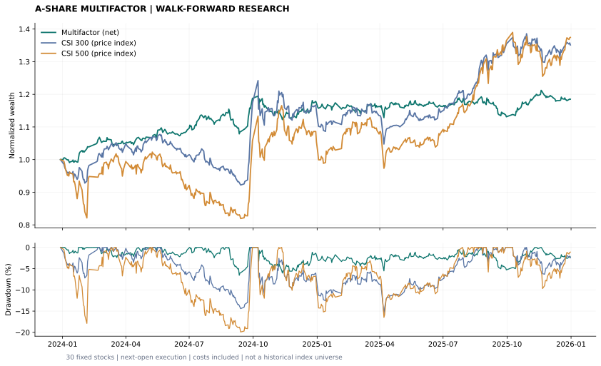
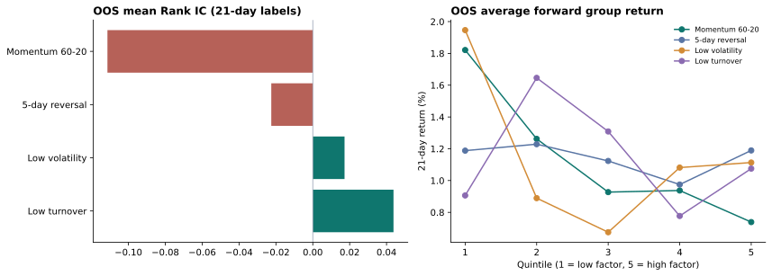
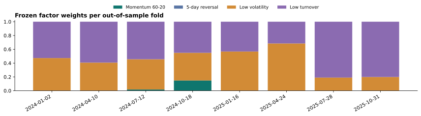

# 基于多因子模型的A股量化选股与滚动回测系统

**A-share Multifactor Stock Selection & Walk-forward Backtesting · V1**

用真实历史行情完成一条可复现的量化研究流程：**因子构建 → 有效性检验 → 滚动估计权重 → 打分选股 → 次日开盘调仓 → 扣费回测 → 指数对比**。

Python · pandas · NumPy · matplotlib ｜30只固定主板股票｜4个量价因子｜8个连续样本外窗口

> 第一版研究原型。固定股票池存在选择与存活偏差，成交和分红采用近似；结果用于展示研究过程，不等于实盘业绩。本次结果跑输两个指数，保留原始参数和全部结果。



## 先看结果

数据预热及训练区间从2022年开始；**样本外回测为2024-01-02至2025-12-31，共485个交易日**。策略收益已扣除配置中的手续费、滑点和卖出税费；两个基准为价格指数。

|组合|累计收益|年化收益|最大回撤|Sharpe|Calmar|
|---|---:|---:|---:|---:|---:|
|多因子策略（扣费）|18.50%|9.22%|−6.56%|0.97|1.40|
|沪深300价格指数|35.13%|16.93%|−15.66%|0.94|1.08|
|中证500价格指数|37.45%|17.97%|−19.90%|0.79|0.90|

策略在该固定样本和区间内回撤较小，但累计收益低于两个指数，**不能据此宣称获得超额收益**。初始资金100万元，总交易成本约1.90万元；报告保留192笔实际成交记录及每次选股排序。

- [完整回测报告与图表](reports/v1/REPORT.md)
- [精确指标 JSON](reports/v1/metrics.json) · [分窗口结果](reports/v1/rolling_windows.csv)
- [每日净值](reports/v1/daily_nav.csv) · [逐笔成交](reports/v1/trades.csv) · [每日持仓](reports/v1/holdings.csv)
- [选股打分](reports/v1/selections.csv) · [训练截止与窗口权重](reports/v1/folds.json)
- [自包含HTML报告](reports/v1/report.html)：下载后用浏览器打开，无需服务器。

## 第一版功能

|模块|已实现|
|---|---|
|行情与快照|公开真实日线、下载重试、缓存、CSV快照、来源及SHA-256校验|
|因子构建|中期动量、短期反转、低波动、低换手；截面截尾与Z-score|
|因子检验|IC、Rank IC、五分组未来收益、样本外汇总|
|组合构建|训练期Rank IC非负加权或固定等权；前5名目标等权|
|滚动回测|252日训练＋63日测试，剔除未成熟标签，测试内冻结权重|
|成交与资金|次日开盘执行、持仓自然漂移、先卖后买、资金约束、费用、未成交记录|
|结果展示|净值、回撤、指数对比、窗口权重、风险指标与静态报告|
|自动验证|14项测试，覆盖未来信息泄漏、标签时序、资金成本、缺报和成交限制|

## 三步运行

需要Python 3.10或以上。在终端执行：

```bash
git clone https://github.com/osnddwqd-hub/a-share-multifactor-backtest.git
cd a-share-multifactor-backtest
python -m pip install -e ".[dev]"
python -m ashare.cli backtest --output reports/local
```

默认直接使用仓库自带真实CSV快照，**回测不联网，不需要API密钥或付费数据**。输出 `reports/local/REPORT.md`、图表、CSV与 `report.html`。也可运行 `python scripts/run_demo.py`。

测试：

```bash
python -m pytest -q
```

仅在需要重新获取行情时运行下面命令。它会覆盖所选数据目录的快照；`configs/v1.json` 默认仍下载2022—2025年，不会自动使用当天行情。

```bash
python -m ashare.cli download --data data/new_snapshot
python -m ashare.cli backtest --data data/new_snapshot --output reports/local
```

修改频率、持股数、等权/IC加权等参数时，复制 `configs/v1.json` 后通过 `--config` 指定。展示结果固定保存于 `reports/v1/`，本地试验默认写入 `reports/local/`。

## 四个因子

所有特征只使用信号日及以前的量价数据。方向是预先设定的假设，并不保证有效。

|因子|定义|处理|
|---|---|---|
|区间动量|P[t−20] / P[t−60] − 1|中期动量，剔除近20日|
|短期反转|−(P[t] / P[t−5] − 1)|近5日收益取负|
|低波动|−近20日收益标准差 × √252|低波动分值较高|
|低换手|−近20日平均换手率|低换手分值较高|

逐日截面1%/99%截尾后Z-score。研究标签为信号后下一开盘到其后21个交易日开盘的收益；五分组图是重叠标签的均值，**不是分组累计净值**。



## 如何避免未来信息进入交易

1. **信号与成交错开**：t日收盘才能计算的因子，最早t+1开盘使用。
2. **标签有独立成熟日期**：训练仅使用 `label_end <= train_cutoff` 的IC记录，剔除跨入未来的训练标签。
3. **测试权重冻结**：每63个交易日才用过去252日重新估计一次，测试结果不反向修改该窗口权重。
4. **完整时序测试**：大幅改写未来价格，检查此前成交和净值保持一致；截断未来数据，检查已有因子保持一致。

默认月初及新测试窗口首日调仓，窗口之间不断仓、不重置资金。权重按训练期平均Rank IC的正值归一化；数据不足或全部非正时退回等权。完整检验与边界见[方法文档](docs/METHODOLOGY.md)。



## 数据和回测边界

- **固定30只主板股票**，并非历史指数成分或完整A股股票池；缺少历史ST、退市与行业中性化处理。
- 数据来源为东方财富公开历史日线；后复权开收盘用于收益，原始行情用于交易限制近似。[快照来源及哈希](data/manifest.json)保留获取时间。
- 原始快照有18条区间内缺报，已在[缺报清单](reports/v1/missing_quotes.csv)逐条记录：暂按前收盘估值，禁止成交，并排除最近61日真实报价不完整的股票。缺报不被冒称为已确认停牌，端点缺失或连续缺报超过15日会报错。
- 手续费3 bp＋滑点5 bp/侧，卖出另加5 bp固定税费。采用分数复权单位，不模拟整手、最低佣金、盘口与精确涨跌停队列；开盘涨跌幅±9.5%为主板限制代理。
- 股票后复权与价格指数分红口径不同；期末按市值结束，无虚拟清仓费。样本内较低回撤不能外推为将来的风险水平。
- 没有实盘下单、券商连接、收益承诺。数据来源方规则适用于行情；MIT许可仅覆盖原创代码和文档。

## 文件导航

|路径|用途|
|---|---|
|`src/ashare/data.py`|下载、校验、缺报显式处理|
|`src/ashare/factors.py`|因子、标签、IC、训练权重|
|`src/ashare/backtest.py`|滚动窗口、成交账本、指标|
|`src/ashare/report.py`|CSV、JSON、图表及报告|
|`configs/v1.json`|全部默认参数和股票池|
|`data/`|真实行情快照、两个指数与哈希|
|`reports/v1/`|已运行并保留的完整展示结果|
|`tests/test_research.py`|关键时序与资金验证|
|`docs/METHODOLOGY.md`|公式、时序、假设和限制|
|`docs/INTERVIEW.md`|项目讲解与复盘提纲|

项目使用AI辅助实现；代码与结果均可本地复查。
