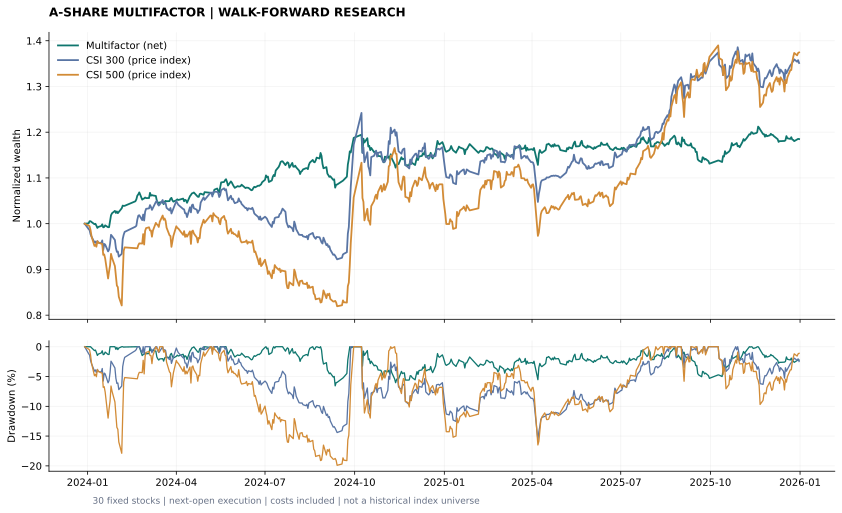
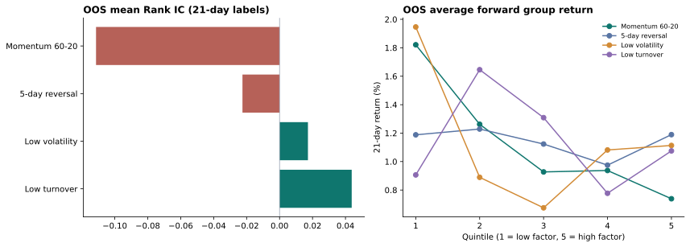
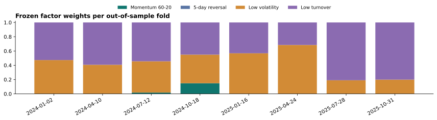

# 第一版真实行情回测报告

回测期间：2024-01-02 — 2025-12-31；485 个交易日，8 个连续样本外窗口。

|组合|累计收益|年化收益|最大回撤|Sharpe|Calmar|
|---|---:|---:|---:|---:|---:|
|多因子策略（扣费）|18.50%|9.22%|-6.56%|0.97|1.40|
|沪深300价格指数|35.13%|16.93%|-15.66%|0.94|1.08|
|中证500价格指数|37.45%|17.97%|-19.90%|0.79|0.90|

初始资金 1,000,000 元；总交易成本 19,012.94 元。
每侧手续费 3.0 bp、滑点 5.0 bp，卖出附加税费 5.0 bp（固定研究假设）。

分组收益是重叠的未来21个交易日平均收益，不是可交易分组净值；ICIR未年化，不做独立样本显著性宣称。

训练使用过去 252 个交易日，剔除标签尚未成熟的日期；每 63 个交易日重新估计因子权重，测试窗口内冻结。月初及新窗口首日用前一交易日收盘信号调仓。

股票池固定为30只主板股票，存在存活与人为选择偏差。后复权收益与价格指数的分红口径不同。采用分数份额和开盘价成交近似，未模拟整手、最低佣金、盘口队列、历史ST名单和完整退市事件。上述收益仅用于检验研究流程。

原始数据及哈希见 `../../data/manifest.json`；逐笔成交、每日持仓、选股打分、窗口结果分别见本目录 CSV。当前截图未按收益筛选参数，保留不利结果。
